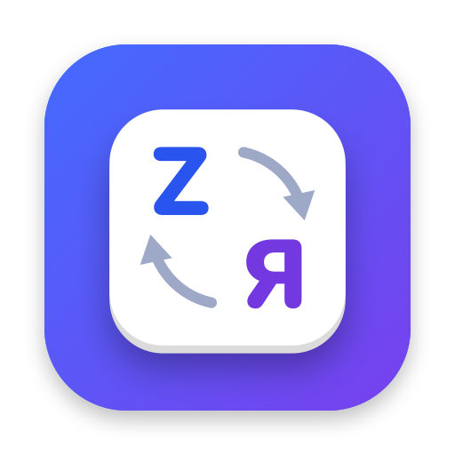

<p align="center"></p>

<h1 align="center">Rasklad</h1>

A tiny macOS menu bar app that fixes text typed in the wrong keyboard layout.
Typed `ghbdtn vbh` instead of `привет мир`? Double-tap **Shift** (or another hotkey you pick) and it's fixed.

Маленькое приложение для macOS: исправляет текст, набранный не в той раскладке, по двойному нажатию Shift.

## How it works

- **Everything you just typed.** Double-tap Shift: all text typed since you last pressed Return,
  clicked, moved the caret, used a shortcut, switched apps or switched the layout by hand is
  erased, re-typed as if the same keys were pressed in the other layout, and the input source is
  switched. Spaces stay as typed.
- **Undo.** Double-tap again right away to switch that text back. If you keep typing after a
  conversion, the next double tap converts only what you typed after it.
- **Selection.** Select text (mouse or Shift+arrows), then double-tap Shift: the selection is
  converted. The clipboard is restored afterwards.
- **Case.** Double-tap **Option** to invert the case of the same text: `пРИВЕТ` → `Привет`,
  `hello` → `HELLO`. It works like the layout fix: the text typed since the last reset (or the
  selection, with the clipboard restored) is re-typed, the layout is not switched, double-tap again
  to switch back. You can mix both: `Ghbdtn` → double Option → `gHBDTN` → double Shift → `пРИВЕТ`.
  Letters with no single-letter counterpart (`ß`) and non-letters stay as they are.
- **Caps Lock** doesn't need to be turned off. Text typed with Caps Lock on is remembered as it
  appeared (upper case); after a case inversion each letter is remembered as typed with or without
  Shift and no Caps Lock, so a later layout fix keeps the new case. Rasklad types its output as
  Unicode characters, so a Caps Lock still on at that moment doesn't change it.
- Works with any layouts enabled in System Settings (ABC, Russian, ...). With more than two,
  repeated taps cycle through them.
- Password fields are never touched (macOS secure input).
- **Feedback.** Each conversion plays a soft "Tink" and shows a small hint like `EN → RU`
  next to the text caret (or the mouse pointer if the app doesn't report the caret). The hint
  fades out in under a second and never takes focus. A case inversion shows `Aa`. Turn either off in the menu:
  «Звук при исправлении», «Подсказка на экране».
- **Excluded apps.** In excluded apps Rasklad neither remembers keys nor reacts to its hotkeys.
  Menu → «Не работать в «…»» toggles the app you were in; «Исключения» lists them (click to remove).
  By default: Terminal, iTerm2, Warp, Ghostty, kitty, Alacritty, WezTerm, all JetBrains IDEs
  (`com.jetbrains.*`, where double Shift is Search Everywhere) and Android Studio.

### Hotkey

Pick the layout trigger in the menu bar menu → **Горячая клавиша** and the case trigger in
**Смена регистра** (same options plus «Выключено»; default: Двойной Option):

| Option | Trigger |
| --- | --- |
| Двойной Shift (default) | double tap of either Shift |
| Двойной Option | double tap of either Option |
| Двойной Control | double tap of either Control |
| Правый Option | single tap of the right Option alone |

A tap counts only when it is clean (no other key, click or modifier in between), short
(< 0.3 s) and, for double taps, the second one comes within 0.45 s. The choice is saved
(`defaults read local.rasklad hotkey`, `defaults read local.rasklad caseHotkey`).

The two actions can't share a modifier key: in each submenu the options on the modifier the
other action uses are greyed out and marked «занято», so to move the layout fix to Option, first
pick another key (or «Выключено») for the case. Double Option and right Option count as the same
key. If the saved choices clash anyway (e.g. you used double Option for the layout before the
case action existed), the layout fix wins and the case action is off until you pick a free key. macOS can use double Control for Dictation; if both
fire, change one of them. Key combos such as ⌥Space are not offered: Rasklad only listens to the
keyboard, so the Space would still reach the app and type a character.

Typed keys are remembered only since the last click, arrow key, Return or shortcut, and only
in memory. Nothing is stored or sent anywhere.

## Download

With [Homebrew](https://brew.sh):

```bash
brew install --cask agentbars/tap/rasklad
```

Or grab `Rasklad-vX.Y.Z.zip` from [Releases](https://github.com/Agentbars/rasklad/releases)
(universal: Apple Silicon and Intel, macOS 13+). Unzip and move `Rasklad.app` to Applications.

The app is not notarized by Apple, so the first launch is blocked: open it once, then go to
System Settings → Privacy & Security → **Open Anyway**. Grant **Accessibility** and
**Input Monitoring** when asked, then relaunch Rasklad from its menu («Перезапустить Rasklad»).

Releases are built by GitHub Actions when a `v*` tag is pushed:

```bash
git tag v0.2.0 && git push origin v0.2.0
```

## Build

Requires macOS 13+ and Xcode (or the Command Line Tools).

```bash
./build.sh install
```

This builds `build/Rasklad.app`, copies it to `~/Applications` and launches it.
On first launch grant **Accessibility** and **Input Monitoring** in
System Settings → Privacy & Security, then relaunch Rasklad.

To keep those permissions across rebuilds, create a local signing certificate once:

```bash
scripts/make-signing-cert.sh
```

Without it the app is signed ad-hoc and macOS asks for permissions again after every rebuild.

## Tests

```bash
./scripts/test.sh
```

Runs the conversion tests (they use the layouts enabled on your Mac and expect ABC or US plus
Russian) and the hotkey detection tests. CI runs the same script on every push and pull request.

## Troubleshooting

Logs (no typed characters, only event kinds and counts):

```bash
/usr/bin/log stream --predicate 'subsystem == "local.rasklad"' --level debug
```

If `launch: ax=false listen=false` stays even though Rasklad is switched on in System Settings,
the switch belongs to an older build. Reset it and grant again, then relaunch:

```bash
tccutil reset All local.rasklad
```

Newly granted permissions are picked up only after Rasklad is relaunched.

## Code

| File | What it does |
| --- | --- |
| `Sources/Layouts.swift` | Enabled layouts, key → character via `UCKeyTranslate`, reverse maps |
| `Sources/Converter.swift` | Typing run (what the hotkey converts), text conversion, case inversion (pure logic) |
| `Sources/KeyMonitor.swift` | Listen-only event tap, typed-keys buffer, both hotkeys |
| `Sources/Hotkey.swift` | Layout and case hotkey choice and conflicts, modifier tap / double-tap detection, submenus |
| `Sources/Exclusions.swift` | Per-app exclusions: list (pure logic), storage, frontmost app, menu items |
| `Sources/TextOutput.swift` | Synthetic backspaces and Unicode typing |
| `Sources/Feedback.swift` | Conversion sound and the `EN → RU` / `Aa` hint near the caret |
| `Sources/main.swift` | Conversion and case actions, selection via clipboard, menu bar UI, permissions, launch at login |

## Icons

All images are drawn from code by `scripts/make-icons.swift` (no binary design files):
the app icon as an Icon Composer bundle (`Resources/AppIcon.icon`, compiled by `build.sh` into a
Liquid Glass icon for macOS 26+ and `AppIcon.icns` for older systems), the menu bar template icon,
`docs/logo.png` and `docs/social-preview.png` (GitHub repo → Settings → Social preview).

```bash
swift scripts/make-icons.swift
```

## License

MIT, see [LICENSE](LICENSE).
